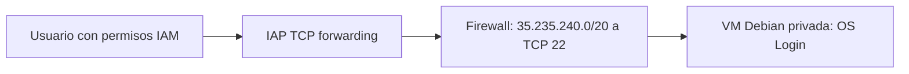
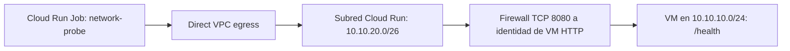
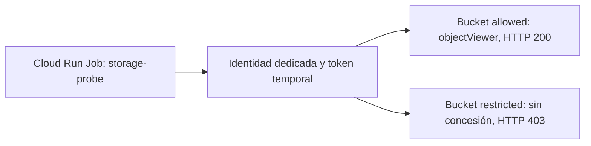

# Arquitectura de CloudFortress

Un único directorio Terraform contiene la base y las tres fases. `lab_phase` selecciona una fase adicional a la vez; no son entornos ni estados independientes. Cambiar la selección puede destruir la fase anterior: utiliza los planes y la limpieza de [las guías](../phases/README.md).

## Base común

La VPC `cloudfortress-vpc` no crea subredes automáticas. `cloudfortress-subnet` usa `10.10.10.0/24` y Private Google Access. No se añaden reglas generales de entrada entre VMs: el tráfico no autorizado encuentra la denegación implícita de la VPC, salvo que otras políticas externas al laboratorio lo permitan.

El servicio original `cloudfortress-hello` utiliza su cuenta de ejecución dedicada. Acepta ingreso desde Internet, requiere autorización IAM y escala de cero a una instancia. No está conectado a la VPC y no participa en las pruebas de los Jobs.

Terraform gestiona las APIs necesarias y las conserva habilitadas después de destruir el laboratorio. El estado es local: consérvalo y no lo subas al repositorio. No se crean balanceadores, Cloud NAT, conectores Serverless VPC Access ni bases de datos.

## Fase 2: administración

La VM usa una identidad dedicada sin roles de aplicación y sin ámbitos OAuth, OS Login y bloqueo de claves SSH de proyecto. No tiene IP pública. El firewall selecciona como destino su cuenta de servicio, en lugar de abrir SSH a toda la subred.

El operador recibe OS Login sin sudo y acceso IAP limitado a esa instancia y a TCP/22. `serviceAccountUser` se limita a la identidad de esa VM. Un rol de proyecto solo con `compute.instances.get`, `compute.instances.list` y `compute.projects.get` permite el descubrimiento de `gcloud`; no concede administración de Compute Engine.

## Fase 3: comunicación privada

El Job enruta rangos privados por la VPC. El servidor usa Python 3 preinstalado, no descarga paquetes y ejecuta systemd con un usuario dinámico sin privilegios. La VM no tiene IP pública ni regla de acceso SSH. Sus identidades no reciben permisos de aplicación sobre Google Cloud.

Las subredes tienen rutas internas en la misma VPC; el firewall determina qué tráfico puede alcanzar el servidor. Deshabilitar su regla bloquea nuevas consultas TCP/8080; el cliente realiza reintentos acotados por el posible retraso inicial de Direct VPC egress.

## Fase 4: autorización de recursos

Cada bucket tiene un objeto de prueba conocido, acceso uniforme y prevención de acceso público. La cuenta del Job recibe únicamente `roles/storage.objectViewer` sobre `allowed`, mediante un binding aditivo. No se cambian políticas completas ni se conceden permisos de almacenamiento a nivel de proyecto.

Al retirar el binding, la expectativa del Job cambia a 403 para ambos objetos; al restaurarlo, vuelve a 200/403. La política es aditiva: permisos heredados externos pueden alterar el resultado y deben investigarse si el bucket restringido permite lectura.

## Operación y límites

- `phase2_iap_ssh_enabled`, `phase3_http_enabled` y `phase4_allow_read` permiten pruebas negativas sin cambios manuales fuera del estado.
- No se ejecutan Jobs automáticamente en un `apply`; cada ejecución y su evidencia son pasos explícitos de Cloud Shell.
- Las imágenes y los tipos de máquina son variables. Las imágenes de ejemplo usan etiquetas; fija un digest o imagen inmutable para repetir exactamente un entorno.
- Las VMs usan Shielded VM con Secure Boot. No tienen salida general a Internet; Private Google Access no equivale a Cloud NAT.
- La protección contra borrado de Cloud Run está desactivada para el laboratorio. Los buckets no fuerzan la eliminación de objetos inesperados y desactivan su retención de borrado lógico.
- Estas pruebas son de laboratorio; no prueban aislamiento frente a todas las políticas de organización, permisos heredados, reglas externas o amenazas de una carga de producción.
